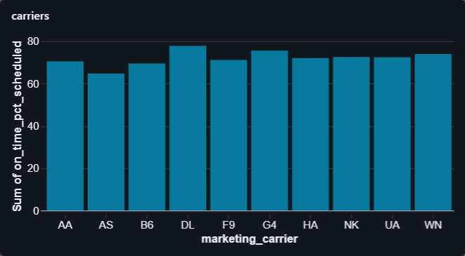
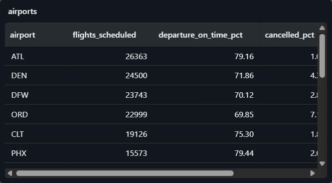
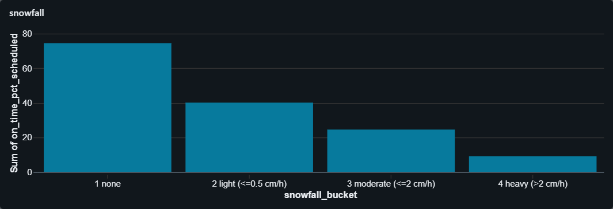

# Flight Operations Pipeline

A medallion-architecture pipeline on Databricks that ingests US domestic
flight on-time data and hourly weather, joins them through bronze, silver and
gold Delta tables, and produces two outputs:

1. **Operational reporting** - on-time performance by route, carrier, airport,
   time of day and weather (SQL dashboard).
2. **A pre-departure delay model** - predicting whether a flight arrives 15+
   minutes late using only information available *before* it leaves the gate.

**Scope: one month (January 2024), 582,425 flights.** Everything below was run
on Databricks Free Edition. Extending to more months is deliberate future work
(see "Limitations").

---

## Results at a glance

| Check | Result |
|---|---|
| Scheduled flights vs DOT published (Jan 2024) | **582,425 = 582,425** (exact) |
| Cancellations vs DOT published | **22,073 = 22,073** (exact) |
| On-time arrival rate, DOT basis (all scheduled flights) | **72.82%** vs published 72.8% |
| Carrier-level rates (AA 70.5, DL 77.8; cancel AS 11.9, UA 6.9) | Match published to one decimal |
| Weather join hit rate | **100%** (582,425 / 582,425) |
| Quality gates | Pass; a deliberately corrupted copy is rejected |
| Delay model vs trailing-rate baseline | **Does not beat it** (see below) |

The reconciliation uses the DOT
[Air Travel Consumer Report, January 2024](https://www.bts.gov/newsroom/air-travel-consumer-report-january-2024-numbers),
built from the same BTS data. Getting the flight and cancellation counts to
match exactly is a strong check on the bronze-to-gold chain: a timezone, typing
or deduplication error would show up as a mismatch.

**Two on-time rates, labelled.** DOT counts cancelled and diverted flights as
not on time (72.8%). Measured only over flights that actually completed, the
rate is 75.9%. These answer different questions; the dashboard states which
one each chart shows.

### Databricks dashboard

[Open the published Databricks dashboard](https://dbc-6bd3e602-0f8b.cloud.databricks.com/dashboardsv3/01f1d23e5c421890a733f9ca0ab9d8cf/published?o=7474651563378919)

| Scheduled flights | On-time arrivals (% of scheduled) | Cancelled flights (%) |
| --- | --- | --- |
|  |  |  |


#### Performance by carrier, airport, route and departure time






#### Weather and pipeline health




### The model result, honestly

Test period: 25-31 January, chronological split (train to 20 Jan, validation
21-23 Jan, a one-day gap, then test).

| | AUC-PR |
|---|---|
| Random guess (delay prevalence) | 0.155 |
| **Trailing route/origin/carrier delay-rate baseline** | **0.210** |
| Logistic regression | 0.197 |
| Gradient boosting | lower than logistic regression |

**Neither model beats the baseline.** The baseline is 36% better than random,
so schedule and recent history carry some signal; the models add nothing on top
of it with one month of data. At the best-F1 threshold, precision is 0.168
against a 0.155 prevalence, so the model is not operationally useful.

I fixed two real mistakes in my first attempt (a random-split early-stopping
setting that contradicted the chronological rule, and "30-day history" rates
built from only 1-3 days), re-ran, and the result barely moved (0.201 to 0.197).
I then stopped tuning on the test week: every further tweak would leak the test
set into model selection. The likely reasons - the training period contains the
mid-January storms while the test week's delay rate falls from 22% to 9%, and
one month gives little history - are in [`docs/decisions.md`](docs/decisions.md).
Per-day, per-carrier and per-hour breakdowns are mixed (the model wins on 6 of
8 test days but loses the two highest-delay days that dominate the pooled
score); those slices were chosen after seeing the test week, so they are
descriptive and not evidence the model works.

**For scale:** adding the departure delay, which is excluded from the feature
table, gives AUC-PR 0.833. That is a deliberate demonstration in the last cell
of `07_model_delay`, not a model. It shows why the leakage rules matter and why
a high score here should be treated as a warning, not a result.

---

## Architecture

```
  SOURCES
    BTS TranStats           Open-Meteo Archive API         OpenFlights
    (monthly CSV/ZIP)       (hourly ERA5, per airport)     (airport lat/lon/tz)
         |                          |                            |
         v                          v                            v
  +----------------------------------------------------------------------+
  |  BRONZE   raw landing, Delta, append-only                            |
  |  flights_raw (all strings + _source_file, _ingested_at)              |
  |  weather_raw (raw JSON per airport)   airports_raw                   |
  +----------------------------------------------------------------------+
         |
         v
  +----------------------------------------------------------------------+
  |  SILVER   typed, deduplicated, timezone-resolved, weather joined     |
  |  dim_airport, flights_completed, flights_disrupted,                  |
  |  weather_hourly, flights_wx                                          |
  |  gates halt the run on bad data                                      |
  +----------------------------------------------------------------------+
         |
         v
  +----------------------------------------------------------------------+
  |  GOLD     business aggregates + ML features                          |
  |  fct_flight_performance, agg_route/carrier/airport/time_block_otp,   |
  |  feat_delay_model (explicit allow-list, pre-departure only)          |
  +----------------------------------------------------------------------+
         |
         v
     Databricks SQL dashboard  +  delay model (MLflow)
```

Bronze holds the source exactly as delivered, so when a dashboard number looks
wrong the pipeline can be separated from the source. Silver is where every
transformation that could be wrong happens. Gold is shaped for consumption;
nothing downstream reads silver directly.

---

## How the known hard problems were handled

**Timezones.** BTS times are local `HHMM` integers with no offset. Scheduled
departure is built from `FlightDate` + `CRSDepTime`, interpreted in the origin
airport's IANA timezone, then converted to UTC. Scheduled arrival is derived as
departure + `CRSElapsedTime`, which sidesteps overnight flights and
cross-timezone arithmetic entirely rather than guessing the arrival date. As a
cross-check, the derived arrival is converted back to destination local time
and compared with the published `CRSArrTime`: 45 of 582,425 flights disagree
(0.008%). `2400` is handled as next-day midnight.

**Overnight flights.** Covered by the derived-arrival approach above.

**Cancelled and diverted flights.** 22,073 cancelled and 1,637 diverted flights
have no valid arrival delay. They are split into `flights_disrupted` and kept
out of delay averages, then reported as separate rates, because averaging them
in as zero would flatter the airline.

**UTC vs local date boundaries.** Found by reasoning before the first join:
flight dates are local and weather is UTC, so late-evening US departures on the
last day (and early Guam departures on the first) fall on a different UTC day.
Weather is fetched for the flight range padded by one day each side.

**Weather API volume.** One request per batch of 10 airports for the whole date
range (about 36 requests), raw JSON cached in bronze, and airports already held
are never re-requested.

**Class imbalance.** About 3 in 4 flights are on time, so accuracy is
meaningless. The model is evaluated with AUC-PR, precision/recall and a
confusion matrix against a trailing-rate baseline.

**Data surprises the checks found:** BTS emits a trailing space in one column
name (`Operating_Airline `) that Delta rejects; two airports (XWA, BIH) were
missing coordinates or timezones in OpenFlights and are added as labelled
overrides; the ERA5 archive returns visibility 100% null, so it was dropped
(the original plan listed it); and my first guess at a maximum plausible
arrival delay (2,000 min) rejected 16 real winter-storm delays of up to 3,136
minutes, so the bound was widened to 72 hours with the reasoning recorded.

---

## Design principles

### Features must be knowable at prediction time

The BTS schema is full of traps. `DepDelay`, `TaxiOut`, `WheelsOff` and the five
delay-cause columns are all recorded after the aircraft leaves the gate. The
model uses only:

- schedule features - hour, day of week, distance, scheduled duration, carrier,
  origin, destination;
- origin-airport weather at the scheduled departure hour;
- trailing route, origin and carrier delay rates.

The feature list is an **explicit allow-list**, so a new BTS column cannot leak
in by default. A second assertion checks the finished table against a list of
known post-departure columns, and both assertions are tested: the notebook
injects `dep_delay_min` and an unknown column and confirms they are rejected.

**Trailing history is keyed on actual arrival date**, using only flights that
landed on a day strictly before the departure date. A flight scheduled
yesterday evening may land after today's flight has left, so its outcome is not
yet known; excluding by scheduled date would leak. A rate needs at least 20
prior flights *and* 7 distinct prior days, otherwise it is NULL, not zero. One
flight's history is recomputed with plain filters and asserted equal to the
table. [`docs/decisions.md`](docs/decisions.md) explains why every excluded
column would leak.

### Quality gates halt the run

Silver asserts: no null keys, positive distances, valid `HHMM` values, every
airport has a timezone, arrival after departure, delay values within bounds, a
unique grain, and no value lost in a cast. A cell then corrupts a copy of the
data and confirms the gates fail it. A gate that has never failed is untested.

### Assumptions are isolated and labelled

Join rules, delay thresholds, tolerances and the 15-minute on-time definition
live in `notebooks/config.py`, each marked as an assumption.

---

## Limitations

- **One month.** The first week has no usable history, `month` is constant, and
  the test week is a single weather regime. The model result should be read
  as "no improvement over a baseline with this little data", not as a verdict
  on the approach.
- **DST not exercised.** January contains no clock changes. Silver converts
  with IANA names, which handle DST, but it must be re-checked before the range
  crosses March or November.
- **Timestamps checked by arithmetic.** LAX-JFK scheduled times were verified
  against the airport UTC offsets and the published `CRSArrTime`; a check
  against an external published schedule for individual flights is still open.
- **Marketing-carrier file.** Rates are by marketing carrier (the brand on the
  ticket, regional partners included), which matches the DOT figure used for
  reconciliation but not an operating-carrier view.
- **Weather is at the origin only** and, from the ERA5 reanalysis, is a
  ~25 km grid value, not an airport observation. Visibility is unavailable.

## Next steps

1. Extend to 3+ months (more history and weather regimes), then re-check DST.
2. Add the **inbound aircraft's delay** (previous leg of the same tail number).
   Late-arriving aircraft is among the largest delay causes and the value is
   genuinely known before the next departure, but it changes the claim from
   "known at schedule time" to "known when the aircraft lands", so it is an
   explicit design decision rather than a quiet addition.
3. Add destination-airport weather and operating-carrier views.

---

## Repository layout

```
notebooks/
  config.py                 every assumption, paths, split dates
  00_setup                  catalog, schemas, volume
  01_bronze_flights         BTS ingest -> Delta, append-only, idempotent
  02_bronze_weather         airports + batched Open-Meteo fetch, cached
  03_silver_flights         typing, dedup, timezones, quality gates
  04_silver_weather_join    parse weather JSON, join at origin + departure hour
  05_gold_aggregates        fact table, OTP aggregates, DOT reconciliation
  06_gold_features          allow-listed features, leakage assertion
  07_model_delay            baseline, models, MLflow, leakage demo
docs/
  build_plan.md             phased plan and progress log
  decisions.md              every judgement call and why
  dashboard_queries.sql     the ten SQL datasets behind the dashboard
  resources.md              setup guide, data dictionaries, references
```

## Running it

Databricks Free Edition. Import the repo as a Git folder, run `00_setup`, upload
the BTS January 2024 ZIP to the Volume's `bts` folder and OpenFlights
`airports.dat` to `reference`, then run `01` to `07` in order. The `%run
./config` cell must run first in each notebook. The dashboard is built from the
queries in `docs/dashboard_queries.sql`.

---

## Licence and attribution

Weather data (c) [Open-Meteo](https://open-meteo.com/), licensed
[CC BY 4.0](https://creativecommons.org/licenses/by/4.0/); the underlying
reanalysis is ERA5 (Copernicus / ECMWF).
Flight data: US Department of Transportation, Bureau of Transportation
Statistics - public domain.
Airport reference data: [OpenFlights](https://openflights.org/data.html).
